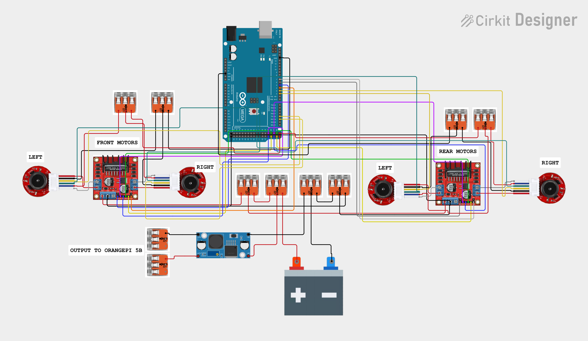
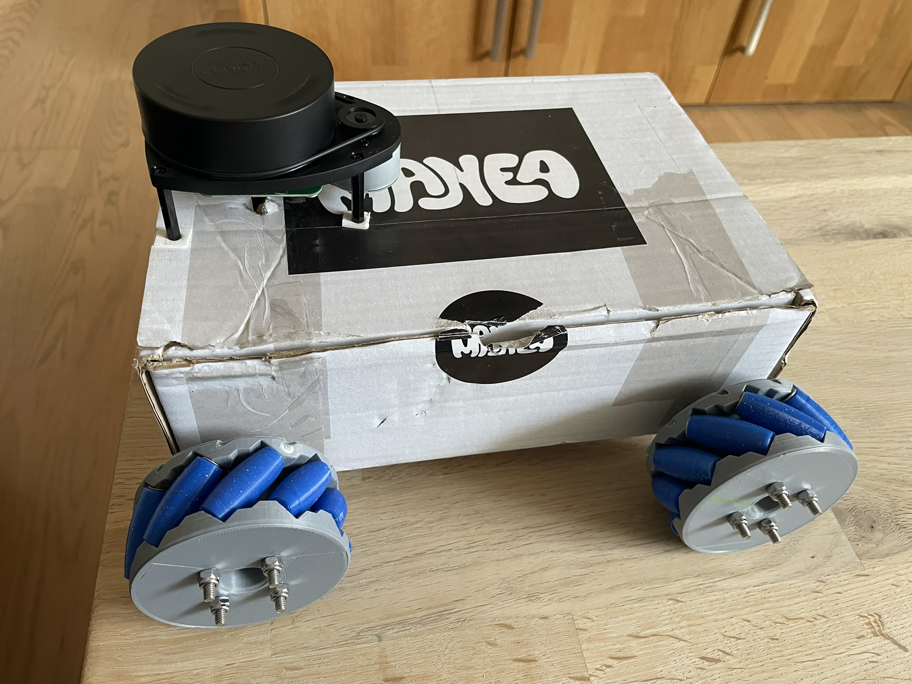
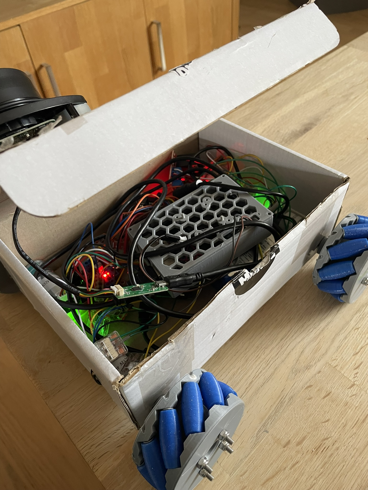
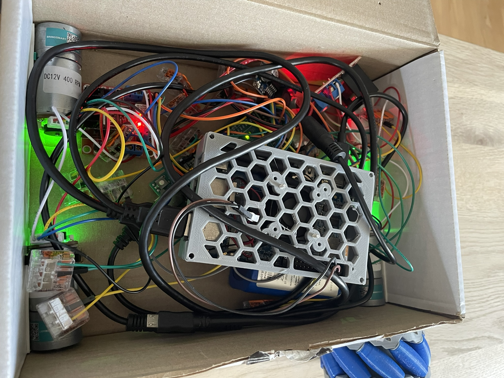

# Omnidirectional Mecanum Robot with ROS 2 Foxy

A custom-built, four-wheeled omnidirectional mecanum mobile robot powered by an **Orange Pi 5B**, an **Arduino Mega** for low-level motor control, an **SLLidar** for 2D laser scans, and managed via **ROS 2 Foxy**. 

This project implements **laser-based odometry** to bypass the severe wheel slip typical of mecanum kinematics, achieving drift-free mapping and localization, combined with **`twist_mux`** for safe priority-based multiplexing between autonomous Nav2 commands and manual joystick overrides.

## System Architecture & Hardware Stack

* **Central Computer:** Orange Pi 5B running ROS 2 Foxy.
* **Microcontroller:** Arduino Mega (handling low-level PWM motor drivers and PID serial communication).
* **Sensors:** Slamtec SLLidar (connected via `/dev/ttyUSB0` with a 180-degree yaw offset for correct front alignment).
* **Drive System:** 4-wheel mecanum drive.
* **Localization Method:** `rf2o_laser_odometry` (Range Flow-based 2D laser odometry, replacing error-prone wheel encoders).
* **Mapping Framework:** `slam_toolbox` & Nav2 (`amcl`, `DWBLocalPlanner`).
* **Control Multiplexer:** `twist_mux` (prioritizing manual joystick over autonomous navigation).

## What Has Been Done (Milestones)

1. **Low-Level Control & Teleoperation:**
   * Developed custom serial communication between the Orange Pi and Arduino Mega (`twist_to_serial.py`).
   * Integrated `teleop_twist_joy` to translate Xbox controller inputs into standard `Twist` velocity commands.
2. **Odometry & Sensor Calibration:**
   * Built and integrated **`rf2o_laser_odometry`** from source for ROS 2 Foxy.
   * Fixed sensor-to-base frame alignments, ensuring correct directional mapping and navigation performance.
3. **Control Safety via `twist_mux`:**
   * Configured `twist_mux` to blend velocities, allowing instant manual safety override via the controller's deadman switch.
4. **Autonomous Navigation (Nav2):**
   * Configured `amcl` for omnidirectional movement.
   * Tuned costmaps, footprints, inflation radiuses, and forced full costmap updates to prevent diagonal RViz shearing and corner clipping.

# Orange Pi & Laptop Workflows

## Network Setup (Orange Pi hotspot + laptop USB Wi-Fi)

The Orange Pi runs its own Wi-Fi hotspot on `wlan0` (**192.168.4.1**). The laptop joins it through a **USB Wi-Fi card** (`wlxaca7f1ccfe81`, gets 192.168.4.x), while its built-in card `wlo1` stays on the home Wi-Fi for internet. DDS must be pinned to the hotspot interface on both sides, otherwise discovery silently fails.

Both machines use `RMW_IMPLEMENTATION=rmw_cyclonedds_cpp` and `ROS_DOMAIN_ID=1`.

**Orange Pi** — `~/cyclonedds.xml`:
```xml
<?xml version="1.0" encoding="UTF-8"?>
<CycloneDDS>
  <Domain id="any">
    <General>
      <NetworkInterfaceAddress>wlan0</NetworkInterfaceAddress>
    </General>
  </Domain>
</CycloneDDS>
```
and in `~/.bashrc`:
```bash
export RMW_IMPLEMENTATION=rmw_cyclonedds_cpp
export ROS_DOMAIN_ID=1
export CYCLONEDDS_URI=file:///home/orangepi/cyclonedds.xml
```

**Laptop (Docker)** — `start_docker.sh` passes all three variables into the container and points `CYCLONEDDS_URI` at `cyclonedds_robot.xml` (pinned to the USB card). If the USB card is ever replaced, update the interface name in that file (`ip -4 addr` → the interface with a 192.168.4.x address). `cyclonedds_wlo1.xml` is the old config and should not be used.

**Docker image** — build/rebuild after any change to `docker/Dockerfile`:
```bash
cd ~/OmnidirectionalPlatform
docker build -t foxy-nav2 docker/
./start_docker.sh
```
To open a second terminal in the running container: `docker exec -it $(docker ps -lq) bash`

**Fix the Orange Pi clock on every boot** (it has no RTC and resets to an old date; wrong time breaks `apt` and makes RViz drop `/scan` and `/tf`). From an `ssh -R 8080` session:
```bash
sudo date -s "$(curl -sI -x socks5h://127.0.0.1:8080 http://google.com | grep -i '^date:' | cut -d' ' -f2-)"
```

**Discovery troubleshooting:** `ros2 daemon stop` and retry; `echo $CYCLONEDDS_URI` on both sides; test with `ros2 run demo_nodes_cpp talker` (Pi) / `listener` (container); `ping 192.168.4.1` should be a few ms when idle.

## Camera (OV2710 USB, 120° FOV)

**On the Orange Pi** (separate terminal from the bringup):
```bash
ros2 run v4l2_camera v4l2_camera_node --ros-args \
  -p video_device:="/dev/video0" \
  -p pixel_format:="YUYV" \
  -p image_size:="[640,480]"
```
Publishes `/image_raw` (~28-30 Hz) and, with `ros-foxy-image-transport-plugins` installed, `/image_raw/compressed`. The "Unable to open camera calibration file" error is harmless.

**On the laptop (container)** — always view the **compressed** topic:
```bash
ros2 topic hz /image_raw/compressed
ros2 run rqt_image_view rqt_image_view   # select /image_raw/compressed
```
> **Warning:** Never subscribe to raw `/image_raw` from the laptop (rqt, RViz, `ros2 topic hz`). Raw 640x480 at 30 Hz is ~200 Mbit/s, which saturates the hotspot and takes down every other topic, including `/scan`. Nodes running on the Pi itself (e.g. YOLO) should use `/image_raw` locally.

**If the LiDAR dies with `SL_RESULT_OPERATION_TIMEOUT`**, unplug and replug it, then relaunch.

## Mode A: Manual Teleoperation

**1. On the Orange Pi :**
Start the hardware bringup (LiDAR, odometry, Arduino bridge, and multiplexer).
```bash
cd ~/ros2_ws_orangepi
source install/setup.bash
ros2 launch omnidirectional_robot robot_bringup.launch.py
```

**2. On the Laptop (inside the docker container):**
Use your controller with the deadman switch to manually drive the robot. Move to the package directory, then:
```bash
ros2 launch ./laptop_launch_files/visualize_omni_robot.launch.py
```

## Mode B: Building a Map (SLAM)

**1. On the Orange Pi:**
Start the hardware bringup (LiDAR, odometry, Arduino bridge, and multiplexer).
```bash
cd ~/ros2_ws_orangepi
source install/setup.bash
ros2 launch omnidirectional_robot mapping.launch.py
```

**2. On the Laptop (inside the docker container):**
Use your controller with the deadman switch to manually drive and position the robot. Move to the package directory, then:
```bash
ros2 launch ./laptop_launch_files/visualize_omni_robot.launch.py
```
*(Drive the robot around the environment until the map looks complete and enclosed in RViz).*

**3. On the Orange Pi (save the map):**
Open a *new SSH terminal* into the Orange Pi and save the map directly into your package's `maps` folder:
```bash
cd ~/ros2_ws_orangepi/src/omnidirectional_robot/maps
ros2 run nav2_map_server map_saver_cli -f my_room_map
```
*(This generates `my_room_map.yaml` and `my_room_map.pgm` directly on the robot).*

## Mode C: Autonomous Navigation

**1. On the Orange Pi:**
Launch the master file. This brings up the hardware AND the Nav2 planners simultaneously. It uses `my_room_map.yaml` by default.
```bash
cd ~/ros2_ws_orangepi
source install/setup.bash
ros2 launch omnidirectional_robot navigation.launch.py
```
*(To use a different map, run: `ros2 launch omnidirectional_robot navigation.launch.py map:=/home/orangepi/ros2_ws_orangepi/src/omnidirectional_robot/maps/other_map.yaml`)*

**2. On the Laptop (inside the docker container):**
Launch the visualization tools. Use the "2D Pose Estimate" button to tell the robot where it is, and the "Nav2 Goal" button to tell it where to drive. Move to the package directory, then:
```bash
ros2 launch ./laptop_launch_files/visualize_omni_robot.launch.py
```

## Person Detection (YOLOv8n on the NPU)

`person_detector` runs YOLOv8n on the Orange Pi's RK3588 NPU, detects people in `/image_raw` and publishes an annotated debug image. It replaces the old LiDAR-only people tracking (DR-SPAAM), which is no longer used. Measured: ~8-10 FPS, model in FP16.

| | |
| --- | --- |
| Subscribes | `/image_raw` (`sensor_msgs/Image`, rgb8), queue depth 1 |
| Publishes | `/person_detector/debug_image/compressed` (`sensor_msgs/CompressedImage`, JPEG) |
| Parameters | `model_path` (default `~/ros2_ws_orangepi/src/omnidirectional_robot/models/yolov8n_rknn_model`) |
| Detection settings | class 0 (person), confidence >= 0.5 |

**Run it on the Orange Pi** (the camera node must be running, see Camera section):
```bash
cd ~/ros2_ws_orangepi
source install/setup.bash
ros2 run omnidirectional_robot person_detector
```

**View the detections on the laptop (container):**
```bash
ros2 run rqt_image_view rqt_image_view   # select /person_detector/debug_image/compressed
```

### One-time setup

Model files live in `models/`, which is git-ignored: copy them by hand to the same folder on the Pi.

**1. Export the model to RKNN (laptop host, not the container).** The converter only runs on x86 Linux with Python <= 3.12, so it gets its own venv:
```bash
cd ~/OmnidirectionalPlatform/models
python3 -m venv ~/rknn-export && source ~/rknn-export/bin/activate
pip install ultralytics "protobuf<7" "numpy<2.4"
yolo export model=yolov8n.pt format=rknn name=rk3588     # creates yolov8n_rknn_model/
deactivate
scp -r yolov8n_rknn_model orangepi@192.168.4.1:~/ros2_ws_orangepi/src/omnidirectional_robot/models/
```

**2. Install the NPU runtime 2.3.2 on the Orange Pi** (must match the toolkit version used for the export). Both files are in `models/rknn-runtime-2.3.2/` on the laptop; copy them to the Pi's home folder with `scp`, then on the Pi (in an `ssh -R 8080` session):
```bash
sudo cp /usr/lib/librknnrt.so /usr/lib/librknnrt.so.1.4.0.bak
sudo install -m 644 ~/librknnrt.so /usr/lib/librknnrt.so
pip3 install --user --proxy socks5h://127.0.0.1:8080 ~/rknn_toolkit_lite2-2.3.2-cp38-*.whl
pip3 install --user --proxy socks5h://127.0.0.1:8080 ultralytics
```
Ultralytics cannot install `rknn-toolkit-lite2` by itself on the Pi (it ignores the proxy), so the wheel is installed manually.

### Known issues

- **Driver warning:** `Current driver version: 0.8.2, recommend to upgrade ... >= 0.8.8` is printed at start-up. It works anyway.
- **NaN boxes in FP16:** when a person is close and fills much of the frame, the FP16 model sometimes returns boxes with NaN values. The node skips them (logs `Skipping a box with NaN/inf values`), but that loses detections at close range. Planned fix: INT8 export, which decodes boxes on the CPU in full precision.
- **Camera focus:** the lens focus is adjustable by turning the lens. Focus it at 1-2 m, the following distance.

---

# Future Improvements & Roadmap
Here is a roadmap of upcoming features and expansions planned for the robot:

1. Sensor Suite Expansions
- ~~Add a Camera~~: RGB camera integrated and streaming to the laptop (see Camera section).
- ~~Person detection~~: YOLOv8n on the NPU (see Person Detection section). Next: pixel to bearing, LiDAR range at that bearing, and a `person_follower` node.

- IMU / Gyro Integration: Incorporate a hardware IMU to fuse high-frequency rotation data with rf2o laser odometry using an EKF (robot_localization).

2. Autonomy & Navigation
- Auto-Docking / Charging: Explore docking logic for automated battery management.

3. Gazebo Simulation & Digital Twin
- Integrate Simulation Models: Import existing wheel meshes, chassis URDF, and sensor plugins into Gazebo to safely benchmark custom path planners.

---

## Project Gallery






## Command Cheatsheet

1. Managing Packages Over SSH Without Ethernet 

If the robot is operating on an isolated network and cannot connect directly to Wi-Fi, you can route the Orange Pi's package manager (`apt`) through your laptop's internet connection using a reverse SOCKS proxy over SSH.

Step 1: Open a Reverse Proxy SSH Session (Laptop Terminal)
Open a new terminal on your laptop and log into the Orange Pi with the `-R` flag to open port `8080`:
```bash
ssh -R 8080 orangepi@<YOUR_ORANGE_PI_IP>
```

Step 2: Run APT Updates & Installs (Orange Pi Terminal)
Inside that SSH session, override apt to route traffic through the local proxy tunnel:
```bash
# Update package lists
sudo apt -o Acquire::http::Proxy="socks5h://localhost:8080" update

# Install ROS 2 or system packages (e.g., Nav2)
sudo apt -o Acquire::http::Proxy="socks5h://localhost:8080" install ros-foxy-navigation2 ros-foxy-nav2-bringup
```

Or to use Git with this method:

```bash
# Push your changes
git -c http.proxy="socks5h://localhost:8080" push origin master

# Pull changes
git -c http.proxy="socks5h://localhost:8080" pull origin master
```

Or to use curl:

```bash
curl -x socks5h://localhost:8080 -O <link to download>
```


